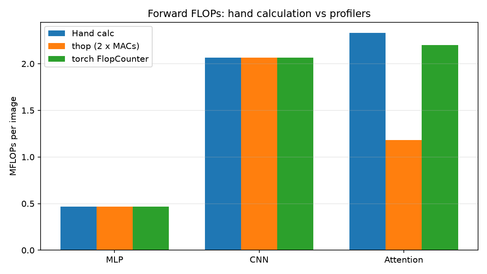
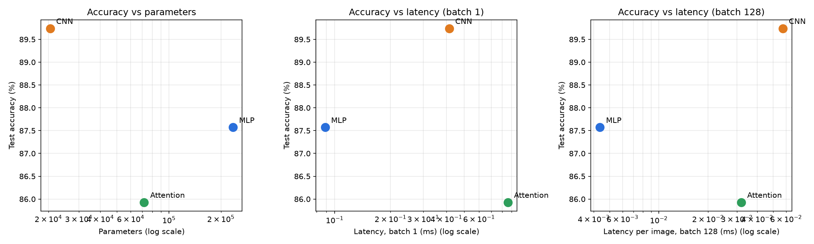

# Lab 3 — Architectures and their costs

**Dataset:** Fashion-MNIST (`torchvision.datasets.FashionMNIST`), `ToTensor()` + `Normalize((0.2860,), (0.3530,))`.
Official 60k train split into 55k train / 5k validation (`random_split`, seed 0); official 10k test. Batch size 128.

**Environment:** <<ENV>>

Code: `lab3.py` (models, profiling, latency, training, plots), `hand_costs.py` (hand calculation, no PyTorch needed).
Raw numbers: `results/results.json`; `torchinfo` summaries: `results/summary_*.txt`; per-layer thop: `results/thop_layers_*.txt`.

---

## 1. Models

| Model | Architecture |
|---|---|
| MLP | Flatten 784 → Linear 256 → ReLU → Linear 128 → ReLU → Linear 10 |
| CNN | Conv2d(1,16,3,p=1) → ReLU → MaxPool2 → Conv2d(16,32,3,p=1) → ReLU → MaxPool2 → Flatten → Linear(32·7·7, 10) |
| Attention | 28×28 → 16 patches of 7×7 → Linear(49, 64) + learned positional embedding (16×64) → 2 × TransformerEncoderLayer (`d_model=64, nhead=4, dim_feedforward=128`) → mean pool over tokens → Linear(64, 10) |

A learned positional embedding was added to the attention model (1,024 parameters). Without it, self-attention followed by mean pooling is permutation-invariant, so the model could not tell which patch came from which part of the image.

**Note on the parameter target (100k–150k).** The architectures as specified do **not** fall into the target range: MLP has 235,146 parameters (1.6× above), CNN 20,490 (5× below), Attention 71,818 (below). I kept the architectures exactly as specified so the cost formulas apply to the prescribed layers, and I take the size mismatch into account when comparing (section 5 normalises accuracy by parameters and latency).

---

## 2. Parameter count (hand vs `torchinfo`)

Hand formulas: Linear = in·out + out; Conv2d = K²·C_in·C_out + C_out; LayerNorm = 2·d; MHA in-projection = d·3d + 3d.

| Layer | MLP | CNN | Attention |
|---|---|---|---|
| Layer 1 | fc1: 784·256+256 = 200,960 | conv1: 9·1·16+16 = 160 | patch embed: 49·64+64 = 3,200; pos-emb 1,024 |
| Layer 2 | fc2: 256·128+128 = 32,896 | conv2: 9·16·32+32 = 4,640 | per encoder layer: QKV 12,480 + out-proj 4,160 + FFN 8,320 + 8,256 + 2×LN 256 = 33,472 (× 2 = 66,944) |
| Layer 3 | fc3: 128·10+10 = 1,290 | fc: 1568·10+10 = 15,690 | head: 64·10+10 = 650 |
| **Hand total** | **235,146** | **20,490** | **71,818** |
| `torchinfo.summary` | <<MLP_PARAMS_TI>> | <<CNN_PARAMS_TI>> | <<ATTENTION_PARAMS_TI>> |

---

## 3. FLOPs: hand calculation vs profilers (one image, forward pass)

Formulas (Ch. *Network Architectures*): Linear `2·in·out`; Conv2d `2·K·K·C_in·C_out·H_out·W_out`; attention QKV `2·S·d·3d`, scores `2·S²·d`, A·V `2·S²·d`, out-proj `2·S·d·d`. S = 16 tokens, d = 64. Bias adds, ReLU, pooling, softmax and LayerNorm are ignored (they are O(N), not O(N·M)).

### Representative layer of each type

| Layer | Calculation | FLOPs |
|---|---|---|
| Linear (MLP fc1) | 2 · 784 · 256 | 401,408 |
| Conv2d (CNN conv2) | 2 · 3 · 3 · 16 · 32 · 14 · 14 | 1,806,336 |
| Attention block (one encoder layer) | QKV 2·16·64·192 = 393,216; scores 2·16²·64 = 32,768; A·V 32,768; out-proj 2·16·64·64 = 131,072 | 589,824 (+ FFN 524,288) |

### Whole models

| | MLP | CNN | Attention |
|---|---|---|---|
| Hand calculation | 469,504 | 2,063,488 | 2,329,856 |
| `thop.profile` MACs | <<MLP_THOP_MACS>> | <<CNN_THOP_MACS>> | <<ATTENTION_THOP_MACS>> |
| `thop` × 2 (≈ FLOPs) | <<MLP_THOP_FLOPS>> | <<CNN_THOP_FLOPS>> | <<ATTENTION_THOP_FLOPS>> |
| thop×2 / hand | <<MLP_THOP_RATIO>> | <<CNN_THOP_RATIO>> | <<ATTENTION_THOP_RATIO>> |
| `torch.utils.flop_counter` | <<MLP_FC_FLOPS>> | <<CNN_FC_FLOPS>> | <<ATTENTION_FC_FLOPS>> |

### Explaining the gap

1. **MACs vs FLOPs.** `thop` reports multiply-accumulates; one MAC = 2 FLOPs. The raw thop numbers are half the hand counts. Once doubled, they match the hand count **exactly** for the MLP and the CNN. Both thop and the hand convention ignore biases, ReLU and MaxPool, so for pure Linear/Conv2d models the formulas `2·in·out` and `2·K²·C_in·C_out·H_out·W_out` are exactly what the profiler measures.
2. **Attention: thop misses the whole attention block and adds LayerNorm.** thop counts FLOPs through forward hooks on known `nn.Module` types. `nn.MultiheadAttention` has no thop rule: inside it the QKV projection uses the raw `in_proj_weight` tensor via `F.multi_head_attention_forward`, and QKᵀ and A·V are tensor ops, not modules. So none of these FLOPs are counted. The FFN layers (`linear1`, `linear2`) are ordinary `nn.Linear` modules and are counted. thop also counts LayerNorm (4 MACs per element: 2 LNs × 16·64 elements × 4 = 8,192 MACs = 16,384 FLOPs per layer), which the hand convention ignores. The gap reconciles exactly:
   - missed attention block, per layer: QKV 393,216 + scores 32,768 + A·V 32,768 + out-proj 131,072 = 589,824 FLOPs; × 2 layers = **−1,179,648**
   - LayerNorm counted by thop: 2 layers × 16,384 FLOPs = **+32,768**
   - 2,329,856 − 1,179,648 + 32,768 = **1,182,976** = measured thop × 2 ✓
3. **Cross-check with `torch.utils.flop_counter`.** It counts at the aten-operator level, so it sees the QKV and out-projection matmuls that thop misses. It matches the hand count exactly for the MLP and the CNN. For attention it reports 2,198,784, which is 131,072 below the hand count, and 131,072 = 2 layers × (32,768 + 32,768). That is exactly the QKᵀ and A·V terms: on CPU, PyTorch dispatches attention to a fused `scaled_dot_product_attention` kernel that has no FLOP formula registered in the counter, so the S²-terms are dropped.
4. **Conclusion.** Every gap is a tooling artefact (MACs vs FLOPs, unhooked functional ops, fused kernels), not an error in the hand formulas. The hand calculation is the only one of the three methods that counts every matmul in the attention model. Profilers are reliable for standard layers but have to be checked for architectures built from functional or fused ops.

---

## 4. Inference latency (CPU, median; batch 1: 100 runs, batch 128: 20 runs, 10 warm-up runs, `inference_mode`)

| | MLP | CNN | Attention |
|---|---|---|---|
| Batch 1 (ms) | <<MLP_LAT1>> | <<CNN_LAT1>> | <<ATTENTION_LAT1>> |
| Batch 128 (ms) | <<MLP_LAT128>> | <<CNN_LAT128>> | <<ATTENTION_LAT128>> |
| Batch 128, per image (ms) | <<MLP_LAT128_IMG>> | <<CNN_LAT128_IMG>> | <<ATTENTION_LAT128_IMG>> |
| Hand FLOPs / image | 0.47 M | 2.06 M | 2.33 M |
| Achieved throughput, batch 1 (GFLOP/s) | <<MLP_GFLOPS_B1>> | <<CNN_GFLOPS_B1>> | <<ATTENTION_GFLOPS_B1>> |
| Achieved throughput, batch 128 (GFLOP/s) | <<MLP_GFLOPS_B128>> | <<CNN_GFLOPS_B128>> | <<ATTENTION_GFLOPS_B128>> |
| Per-image speed-up from batching (×) | <<MLP_BATCH_SPEEDUP>> | <<CNN_BATCH_SPEEDUP>> | <<ATTENTION_BATCH_SPEEDUP>> |

Achieved throughput = hand FLOPs × batch / latency. Fastest at batch 1: **<<FASTEST_B1>>**; fastest at batch 128: **<<FASTEST_B128>>**.

**FLOPs do not predict latency.** At batch 1 the attention model is about 2× slower than the CNN for only 13% more FLOPs. At batch 128 the order flips: attention is about 1.8× *faster* than the CNN even though it does more work. The MLP has 4.4× fewer FLOPs than the CNN, yet at batch 1 it is only about 4.7× faster. The explanation is in the access patterns (section 6), not in the FLOP counts.

---

## 5. Accuracy after 5 epochs (Adam, lr 1e-3, batch 128)

| | MLP | CNN | Attention |
|---|---|---|---|
| Validation accuracy, epoch 5 (%) | <<MLP_VAL>> | <<CNN_VAL>> | <<ATTENTION_VAL>> |
| **Test accuracy (%)** | **<<MLP_ACC>>** | **<<CNN_ACC>>** | **<<ATTENTION_ACC>>** |
| Parameters | <<MLP_PARAMS>> | <<CNN_PARAMS>> | <<ATTENTION_PARAMS>> |
| Accuracy (%) per 100k params | <<MLP_ACC_PER_100K>> | <<CNN_ACC_PER_100K>> | <<ATTENTION_ACC_PER_100K>> |

Highest test accuracy: **<<BEST_ACC>>**.

---

## 6. Discussion: which architecture is most cost-effective?

**Parameters vs FLOPs do not move together.** The MLP has the most parameters (235k) but the fewest FLOPs (0.47 M): every weight is used exactly once per image. The CNN is the reverse: 20k parameters but 2.06 M FLOPs, because each 3×3 filter is reused at every spatial position (784 positions for conv1, 196 for conv2). The attention model reuses its projection weights across 16 tokens and adds the S² score computation: 72k parameters and 2.33 M FLOPs. Model size and compute are separate costs, and as the latency table shows, neither one alone predicts speed.

**Access patterns (Ch. *Network Architectures*, §6.8 Shared Building Blocks and §6.9 Computational Primitives: Table 6.10 "Primitive Utilization", Table 6.11 "Memory Access Complexity").**

- **MLP: dense GEMM, sequential access, broadcast.** Weights are streamed contiguously and each weight is used once per image, so at batch 1 every layer is a matrix-vector product with about 0.5 FLOP/byte. That is memory-bound, and the achieved throughput is low (<<MLP_GFLOPS_B1>> GFLOP/s). Latency is still the lowest (<<MLP_LAT1>> ms) because there are only three operations and 0.47 MFLOPs, and the 0.94 MB of FP32 weights fit in the CPU cache. At batch 128 the same weights are reused across 128 images (matrix-matrix), arithmetic intensity grows about 128×, and throughput rises to <<MLP_GFLOPS_B128>> GFLOP/s. That is the largest gain of the three models from sequential, well-tiled GEMM access.
- **CNN: convolution, strided sliding-window access.** The weights are tiny (82 KB) and reused at every spatial position. Yet the CNN reaches only <<CNN_GFLOPS_B128>> GFLOP/s at batch 128, the lowest of the three, and gains only <<CNN_BATCH_SPEEDUP>>× from batching. Two access-pattern effects cause this. (1) The strided 3×3 windows must be lowered (im2col or a direct kernel) into GEMMs with a very skinny reduction dimension: conv1 has K²·C_in = 9 and conv2 has 144, against 784 and 256 for the MLP layers, so the GEMM units are poorly fed. (2) The activation storage is O(B·H·W·C) (Table 6.11): conv1 alone produces 128 × 16 × 28 × 28 floats = 6.4 MB at batch 128. That is more than the cache can hold, so ReLU and MaxPool stream it through DRAM. On a CPU the CNN is limited by activation traffic, not by its weights.
- **Attention: GEMM + attention, tiled QKV streams, gather + reduce.** At batch 1 attention is the slowest (<<ATTENTION_LAT1>> ms, <<ATTENTION_GFLOPS_B1>> GFLOP/s). Each encoder layer runs about a dozen small kernels (unfold/reshape, QKV projection, head split, SDPA, out-projection, two residual adds, two LayerNorms, two FFN GEMMs). Each one works on a 16 × 64 tile, so per-operator dispatch overhead dominates, not arithmetic. At batch 128 the picture changes: every projection becomes a GEMM with B·S = 2,048 rows and a reduction dimension of 64–128, which is exactly the "tiled QKV streams" pattern that CPU BLAS handles well. The activations are only 128 × 16 × 64 floats = 0.5 MB per tensor, so they stay in cache. Throughput rises <<ATTENTION_BATCH_SPEEDUP>>× to <<ATTENTION_GFLOPS_B128>> GFLOP/s, about 2× the CNN's, and attention overtakes the CNN despite more FLOPs. The quadratic S² term (2 × 32,768 FLOPs per layer, about 5.6% of the total) is negligible at S = 16.

**Conclusion.**

- **Accuracy:** the CNN is best (<<CNN_ACC>>%), the MLP is <<MLP_ACC>>%, and attention <<ATTENTION_ACC>>%. The CNN's locality and weight-sharing bias matches images. The attention model, with only 16 coarse 7×7 tokens and 5 epochs from scratch, lacks that bias and underfits (it also has the highest training loss). This is consistent with the book's note that ViTs need large-scale data to compete with CNNs.
- **Accuracy per parameter:** the CNN wins by an order of magnitude (<<CNN_ACC_PER_100K>>% per 100k params, against <<MLP_ACC_PER_100K>> for the MLP and <<ATTENTION_ACC_PER_100K>> for attention). It is 2 pp more accurate than the MLP with 11× fewer parameters.
- **Latency:** the MLP is fastest at both batch sizes, but it pays with 11× more parameters and about 2 pp lower accuracy than the CNN. Attention is the slowest per request (batch 1) but beats the CNN in batched throughput.

**Most cost-effective: the CNN.** It gives the highest accuracy with the smallest memory footprint (82 KB of weights), and its batch-1 latency (<<CNN_LAT1>> ms) is well under a millisecond. When parameter memory or bandwidth is the constraint (edge devices, Table 6.11's parameter-storage column), nothing else comes close. The trade-offs depend on the deployment regime. If only single-image CPU latency matters and a 2 pp accuracy loss is acceptable, the MLP is the cheaper choice. For high-throughput batched serving on this CPU, attention's GEMM-friendly access pattern would beat the CNN on speed, but here it is also the least accurate model, so it is not cost-effective at this scale.

**Limitations.** Latency was measured on a CPU (<<ENV>>). There, cache size and operator dispatch dominate small models; on a GPU the ranking, especially the CNN's poor batched throughput, may change. Only 5 epochs and one seed were used, so accuracy differences below about 0.5 pp are within noise. The models are not size-matched (see §1).
